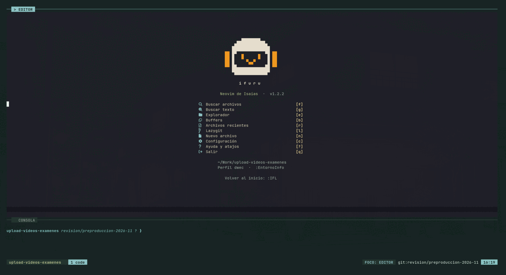
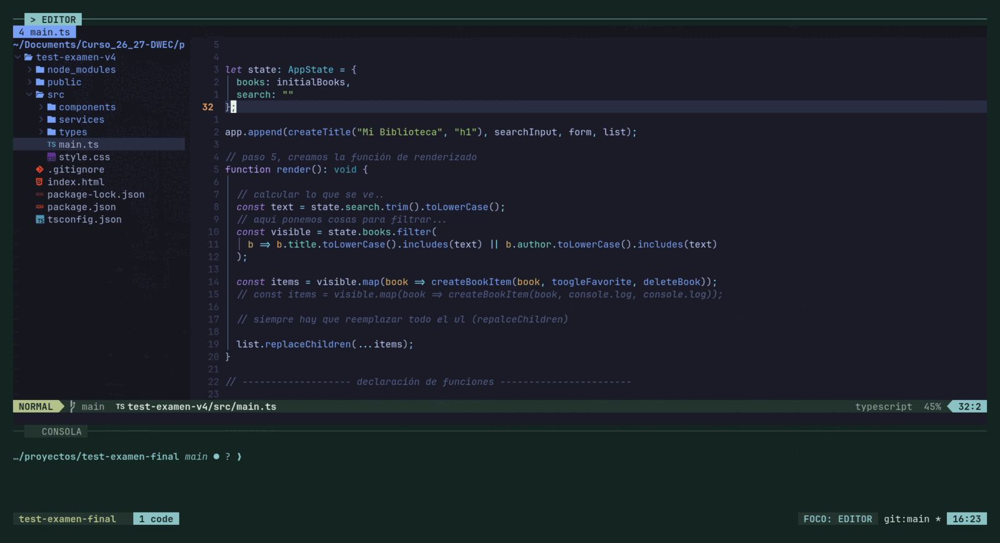
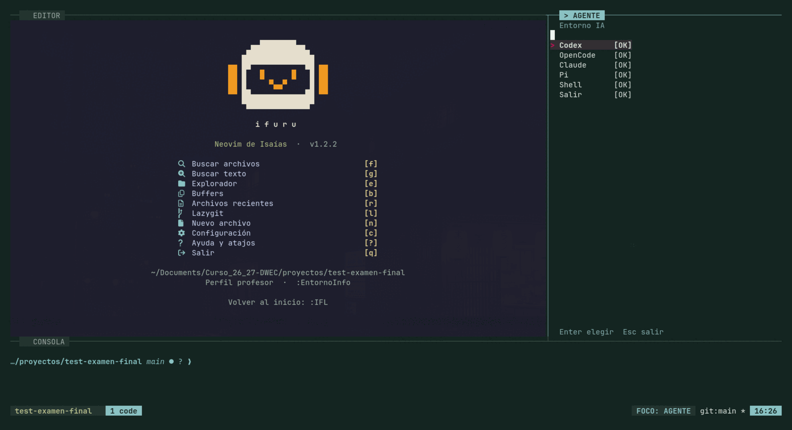
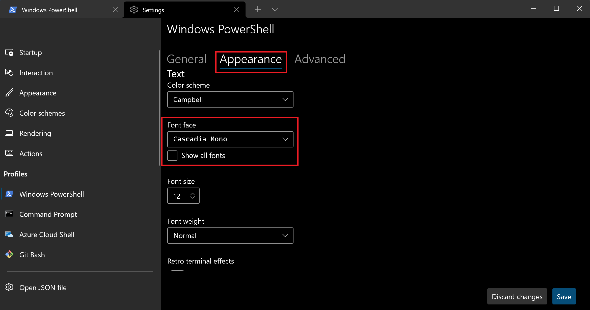
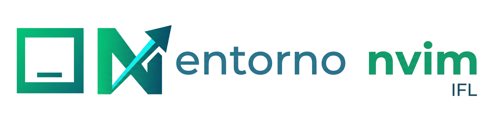
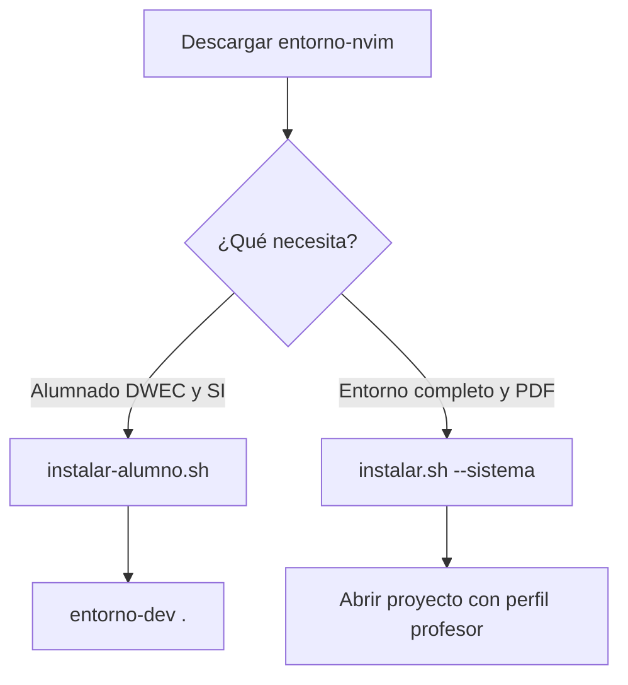

<p align="center">
  
</p>

<h1 align="center">entorno-nvim</h1>

<p align="center"><strong>Ifuru</strong> · IFL → イフル</p>

<p align="center"><em>Neovim de Isaías: desarrollo, docencia y Markdown/PDF.</em></p>

## Stack

| | Capa | Qué usa |
| :--: | --- | --- |
|  | **Editor** | Neovim 0.12.4, configuración modular en Lua |
|  | **Plugins** | lazy.nvim con todas las versiones fijadas en `lazy-lock.json` |
|  | **Terminal** | tmux con paneles de editor, consola y agente |
| 🔍 | **Búsqueda** | fzf-lua sobre ripgrep y fd |
|  | **LSP** | lua-language-server 3.19.0, Pyright 1.1.411, TypeScript, HTML, CSS, JSON, Tailwind, Bash y Docker |
|  | **Formato al guardar** | Prettier 3.9.10, Ruff 0.17.5, shfmt y los servidores LSP |
|  | **Node** | 24.21.0 con pnpm 11.18.0, solo para los servidores LSP |
| 🌳 | **Parsers** | Tree-sitter CLI 0.26.11 |
|  | **Git** | lazygit, con delta opcional para los diffs |
|  | **Markdown/PDF** | mdcat, Pandoc y Chromium (perfil de profesor) |
|  | **Sistemas** | Debian 13, Ubuntu 24.04/26.04, WSL2 y CachyOS/Arch; macOS parcial |
|  | **Instalación** | Shell POSIX, binarios oficiales verificados con SHA-256, sin `sudo` sin permiso |

> **Sin dependencias ocultas.** No hay Node global, ni paquetes de npm sueltos,
> ni plugins sin versión fija. Lo que no está instalado se detecta y se avisa, y
> el entorno sigue funcionando en texto.

*Iconos de [Simple Icons](https://simpleicons.org/) (CC0). Procedencia y
limitaciones en [IMG/icons/FUENTES.md](IMG/icons/FUENTES.md).*

## Índice

- [Stack](#stack)
- [Vista rápida](#vista-rápida)
- [Alumnado: empiece aquí](#alumnado-empiece-aquí)
  - [Windows 11 con WSL2](#windows-11-con-wsl2)
  - [Casos habituales](#casos-habituales)
    · [Trabajar cada día](#trabajar-cada-día) · [Si algo falla](#si-algo-falla)
- [Fuentes e iconos (Nerd Font)](#fuentes-e-iconos-nerd-font)
- [Qué es](#qué-es) · [Qué incluye](#qué-incluye)
- [Instalación completa y opciones](#empiece-aquí-elegir-la-instalación)
- [Comprobar requisitos](#comprobar-requisitos)
- [Usar entorno-dev desde cualquier carpeta](#usar-entorno-dev-desde-cualquier-carpeta)
- [Restaurar](#restaurar) · [Actualización](#actualización) · [Desinstalación](#desinstalación)
- [Neovim](#neovim) · [tmux](#tmux) · [Agentes](#agentes) · [Markdown/PDF](#markdownpdf) · [LSP](#lsp)
- [Mappings principales](#mappings-principales)
- [Portabilidad](#portabilidad) · [Seguridad](#seguridad)
- [Licencia](#licencia)

**[Guía completa de teclas y uso](docs/guia-completa-teclas.md)**: editor,
explorador, pestañas, tmux, consola, IA, PDF, autocompletado y LazyGit.

**[Chuleta para alumnado](chuleta_comandos.md)**: instalación,
sesiones tmux, edición básica en Neovim, diagnósticos y ejecución de Bash.

**[Pi y Jarvis para alumnado](docs/pi-jarvis-alumnado.md)**: guía de piloto para
instalar Pi, configurar Tutor y Coder y proteger la clave personal.

**[Fragmento HTML para Moodle DWEC](docs/moodle-dwec.html)**: entrada breve con
instalación, enlaces, bloques de comandos, atajos e incidencias.

## Vista rápida



*La bienvenida: mascota, versión, perfil y accesos directos.*



*El editor con el árbol, la barra de estado y la consola de tmux.*



*Agentes CLI dentro del editor: Codex, OpenCode, Claude, Pi y una consola, cada
uno en su panel. Es opcional: el perfil de alumnado no instala agentes ni pide
credenciales.*

## Alumnado: empiece aquí

> [!IMPORTANT]
> **Instalación en una línea** — Linux o terminal de WSL2
>
> ```sh
> curl -fsSL https://raw.githubusercontent.com/isaiasfl/entorno-nvim/main/install.sh \
>   | bash
> ```
>
> Descarga el entorno en `~/entorno-nvim`, lo instala y, al terminar, abre una
> terminal nueva con `entorno-dev` listo. Si ya lo tenía, actualiza en lugar de
> duplicar.

> **Requisito:** una terminal de **Linux**. En Windows 11, la de **WSL2**
> (Ubuntu), nunca PowerShell ni una carpeta `/mnt/c`.

### Windows 11 con WSL2

1. **Instale WSL2** en PowerShell **como administrador**:
   ```powershell
   wsl --install -d Ubuntu
   ```
   Reinicie si se lo pide. Al abrir Ubuntu le pedirá un usuario y una
   contraseña **de Linux** (no son las de Windows).
2. **Dentro de Ubuntu**, ejecute el mismo comando de una línea que en Linux:
   ```sh
   curl -fsSL https://raw.githubusercontent.com/isaiasfl/entorno-nvim/main/install.sh \
     | bash
   ```
3. **Iconos (opcional):** si ve cuadros en lugar de iconos, falta una fuente
   Nerd Font. En WSL se instala **en Windows**, no en Ubuntu: siga
   [Fuentes e iconos](#fuentes-e-iconos-nerd-font) o escriba `:EntornoIconos 0`
   dentro del editor para seguir en texto.

> **En WSL, clone en su carpeta de Linux** (`~`). Las carpetas de Windows son
> lentas y no admiten los sockets de Neovim.

**El mismo `scripts/instalar-alumno.sh` sirve para Intel/AMD (x86_64) y
ARM64 (por ejemplo, Snapdragon con Windows y WSL2).** Detecta la arquitectura
y descarga Neovim y Node nativos, con versiones y SHA-256 fijados. No hay que
elegir otro script ni pasar una opción ARM. Los paquetes del sistema se
obtienen del gestor de Linux, que selecciona la arquitectura correspondiente.

En Windows, primero debe tener **WSL2 con Ubuntu o Debian**; ARM de 32 bits y
Windows sin WSL no están admitidos. El instalador general del profesor
(`instalar.sh`, con PDF/LuaLS/Tree-sitter) conserva sus propios límites.

**Validación:** instalación y repetición reales del carril de alumnado en
Linux x86_64 (Debian 13 y Ubuntu 26.04, también en máquinas virtuales);
detección simulada y artefactos oficiales verificados para ARM64. La
instalación completa en un portátil WSL2 ARM64 sigue pendiente; no se
presenta como probada en ese hardware.

### Casos habituales

> Si nunca lo ha instalado, vaya a la [instalación en una línea](#alumnado-empiece-aquí). Esta
> sección es para repetir, actualizar o salir de un atasco.

#### Caso 1: instalación paso a paso

Si prefiere ver los comandos uno a uno, o quiere comprobar qué hace el
instalador:

```sh
cd ~
git clone https://github.com/isaiasfl/entorno-nvim.git
cd entorno-nvim
./scripts/instalar-alumno.sh
```

Instala el entorno completo del alumnado, igual para DWEC y SI: HTML, CSS,
JavaScript, TypeScript, React, Tailwind, Bash, Python, Dockerfile y Docker
Compose. Si faltan programas del sistema, los muestra y pregunta antes de
instalarlos (pedirá su contraseña). Al terminar ofrece añadir `entorno-dev`
al PATH: responda `s`.

#### Si falló la instalación anterior en ARM64

Si ya descargó el repositorio y el instalador anterior rechazó ARM, no hace
falta borrar su carpeta. Desde WSL2, guarde su trabajo y ejecute:

```sh
cd ~/entorno-nvim
./scripts/actualizar.sh
```

El actualizador descarga los cambios y ejecuta el instalador compatible.
Funciona aunque la instalación anterior no llegara a guardar el perfil:
en ese caso pide Enter para comenzar. Si no existe `scripts/actualizar.sh`,
use el caso 3 de abajo.

Si Git avisa de cambios locales, consérvelos o consulte al profesor antes de
descartarlos. Si falla de nuevo, copie el mensaje completo y la salida de
`uname -m` y `cat /etc/os-release` (sin datos personales ni credenciales).

#### Caso 2: ya lo tenía instalado y tiene `scripts/actualizar.sh`

Guarde su trabajo y ejecute:

```sh
cd ~/entorno-nvim
./scripts/actualizar.sh
```

Descarga la versión nueva, ofrece cerrar las sesiones abiertas y reinstala
todo lo nuevo. Pulse Enter si pregunta. **No hace falta reinstalar a mano:**
aunque instalara antes solo DWEC o solo SI, la actualización completa lo que
falte (web, Bash, Python y Docker).

#### Caso 3: ya lo tenía instalado, pero su copia no tiene `actualizar.sh`

Solo la primera vez:

```sh
cd ~/entorno-nvim
git pull --ff-only
sh scripts/actualizar.sh
```

Si Git avisa de cambios locales (por ejemplo, finales de línea `^M` o
`lazy-lock.json`), consulte al profesor antes de descartarlos. Desde entonces,
use el caso 2.

#### Caso 4: empezar de cero (si algo sigue fallando)

Guarde su trabajo y descargue una copia limpia; la antigua se conserva por
si acaso:

```sh
tmux -L entorno-nvim kill-server
cd ~
mv entorno-nvim entorno-nvim.antiguo
git clone https://github.com/isaiasfl/entorno-nvim.git
cd entorno-nvim
./scripts/instalar-alumno.sh
```

El comando `entorno-dev` se redirige solo a la copia nueva. Cuando compruebe
que todo funciona, puede borrar la antigua: `rm -rf ~/entorno-nvim.antiguo`.

### Trabajar cada día

```sh
cd ~/ruta/de/mi-proyecto
entorno-dev .
```

Abre Neovim arriba y una terminal abajo. Dentro de Neovim, pulse `Espacio`
y espere: aparece el menú con todas las acciones. Si la terminal dice que no encuentra
`entorno-dev`, abra una terminal nueva o use `~/entorno-nvim/bin/entorno-dev .`

Si ve cuadros en lugar de iconos, no está roto: falta una Nerd Font. Resumen en
[Fuentes e iconos](#fuentes-e-iconos-nerd-font), o `:EntornoIconos 0` para
seguir en texto.

### Si algo falla

```sh
cd ~/entorno-nvim
./scripts/instalar-alumno.sh --comprobar
```

Copie el mensaje completo y envíelo al profesor. Problemas habituales en
[la guía del alumno](docs/alumno.md#5-solución-de-problemas).

## Fuentes e iconos (Nerd Font)

Los iconos del menú, del árbol de archivos y de la barra inferior son glifos
de **Nerd Font**. Sin esa fuente, la terminal dibuja cuadros o huecos.

> **No está roto.** El entorno funciona igual en texto; las fuentes son solo
> para ver los iconos.

Tiene dos salidas y las dos son correctas:

- **Seguir sin iconos**, sin instalar nada: escriba `:EntornoIconos 0` dentro
  del editor. El texto y todas las funciones siguen igual, y la elección se
  guarda.
- **Instalar la fuente** y mantener los iconos. Después, `:EntornoIconos 1`.

### Fuentes en Windows 11 (Windows Terminal y VS Code)

1. Descargue **JetBrainsMono Nerd Font** desde
   <https://www.nerdfonts.com/font-downloads> y descomprima el `.zip`.
2. Seleccione todos los archivos `.ttf`, botón derecho →
   **Instalar para todos los usuarios**. En Windows 11 esa opción puede estar
   en «Mostrar más opciones» (o pulse `Mayús+F10`).
3. **Windows Terminal:** `Ctrl+,` → perfil de **Ubuntu** → **Apariencia** →
   **Tipo de letra** → `JetBrainsMono Nerd Font` → **Guardar**.
4. **VS Code:** en la configuración de usuario (no la del proyecto) añada:
   ```json
   "terminal.integrated.fontFamily": "JetBrainsMono Nerd Font"
   ```
5. Cierre **todas** las ventanas de la terminal y abra `entorno-dev` de nuevo:
   la fuente se elige al abrir la ventana.



*Windows Terminal → perfil → Apariencia → **Font face**. Captura de la
documentación oficial de Microsoft (CC BY 4.0); procedencia en
[IMG/nerdfont/FUENTES.md](IMG/nerdfont/FUENTES.md).*

> Una fuente instalada dentro de Ubuntu no cambia nada: quien dibuja los
> caracteres es Windows Terminal.

### Fuentes en Linux

```sh
mkdir -p ~/.local/share/fonts
cp JetBrainsMono*.ttf ~/.local/share/fonts/
fc-cache -f
```

Después elija `JetBrainsMono Nerd Font` en las preferencias de su terminal
(GNOME Terminal, Konsole, Alacritty, Kitty, WezTerm...). Para comprobar que el
sistema la ve:

```sh
fc-list | grep -i "nerd font"
```

### Comprobar cuál está activa

Dentro del editor, `:EntornoIconos` muestra el estado y una línea de muestra:
si se ve bien, la fuente sirve; si salen cuadros, no. El comando no instala ni
modifica nada fuera del repositorio.

## Qué es



*Nuestra mascota **Ifuru**: las letras IFL, escritas en japonés.*

`entorno-nvim` es una configuración de Neovim y tmux comprensible, versionada y
reversible para programación, docencia y documentos Markdown. La versión actual
figura en `VERSION` y en la portada del editor; la referencia probada es Debian
13 con Neovim 0.12.4.

La evolución docente portable ya dispone de perfiles y arranque mínimo sin
dependencias opcionales. Consulte [estado y uso actual](docs/entorno-docente.md);
la V1 descrita más abajo es la referencia histórica completa en Debian.

## Qué incluye

- Neovim modular en Lua, dashboard IFL, búsqueda, explorador y Git.
- LSP nativo para Lua, web (HTML, CSS, JS, TS, React, Tailwind), Python, Bash y Docker; completado nativo de Neovim 0.12 y formato al guardar con Prettier, Ruff y `shfmt`.
- Tree-sitter con ocho parsers externos fijados.
- sesiones tmux por proyecto en el socket dedicado `entorno-nvim`;
- Markdown → HTML/CSS → Chromium → PDF A4 (Pandoc opcional, sólo para PDF).
- Ortografía en español e inglés en Markdown y texto: faltas en rojo, menú `Espacio o`.
- `scripts/actualizar.sh` para actualizar con un solo comando.

El [inventario V1](docs/inventario-v1.md) detalla componentes y versiones.

## Empiece aquí: elegir la instalación

Descargue el repositorio y consulte la ayuda si tiene dudas:

```sh
git clone https://github.com/isaiasfl/entorno-nvim.git
cd entorno-nvim
./scripts/instalar.sh --help
```

**Para el alumnado (DWEC y SI), use el instalador de alumno. Para el entorno completo
con Markdown/PDF, use el instalador general.** Son alternativas; no necesita
ejecutar los dos.



### Comandos para instalar y abrir

Ejecute desde la carpeta del repositorio la pareja que corresponda:

| Uso | Instalar | Abrir su proyecto |
| --- | --- | --- |
| Alumnado DWEC y SI: web, Bash, Python y Docker | `./scripts/instalar-alumno.sh` | `./bin/entorno-dev /ruta/a/mi-proyecto` |
| Profesor: entorno completo y Markdown/PDF | `./scripts/instalar.sh --sistema` | `./bin/entorno-dev --perfil profesor --sin-ia /ruta/a/mi-proyecto` |

Sustituya `/ruta/a/mi-proyecto` por la carpeta de su proyecto. Para abrir la
carpeta actual, use `.`. `--sin-ia` permite empezar con editor y terminal;
la IA es opcional y requiere un cliente ya instalado y configurado.

Antes de instalar se muestra el plan y se pide **Enter para comenzar**;
Ctrl+C cancela. La ayuda y la comprobación no inician una instalación.

### Qué significan las opciones

| Opción | Dónde se usa | Efecto |
| --- | --- | --- |
| `--yes` o `-y` | Ambos instaladores | Omite solo la pausa inicial para automatización; no autoriza sudo |
| `--help` o `-h` | Ambos instaladores | Muestra ayuda y termina sin instalar |
| `--perfil dwec` / `--perfil si` | Instalador de alumno | Se aceptan por compatibilidad; instalan lo mismo que sin opción |
| `--sistema` | Instalador general | Ofrece instalar los paquetes del sistema que falten; muestra el comando y pide confirmación antes de usar sudo |
| `--sin-sistema` | Instalador de alumno | Nunca usa sudo; solo indica qué paquetes faltan. Sin esta opción pregunta antes de instalarlos |
| `--comprobar` | Instalador de alumno | Comprueba la instalación sin descargar ni modificar |

El instalador de alumno pregunta antes de instalar paquetes del sistema que
falten; acepta `--sistema` por compatibilidad. Sin `--sistema`, el instalador
general prepara sus componentes locales y muestra cómo resolver los paquetes
del sistema que falten. El instalador general no
acepta `--perfil` ni `--comprobar`. Para comprobar requisitos generales:

```sh
./scripts/comprobar-requisitos.sh
```

### Qué cambia en su equipo

Ambas instalaciones mantienen Neovim separado: **no sustituyen
`~/.config/nvim` ni `~/.tmux.conf`**. Neovim, Node, plugins y servidores de
lenguaje se preparan dentro del repositorio. El instalador de alumno también
prepara el lanzador `entorno-dev` en `~/.local/bin`; puede usar siempre
`./bin/entorno-dev` sin depender de su PATH.

El alumnado no necesita las herramientas PDF. La instalación completa las
incluye en su flujo. Los paquetes del sistema se obtienen del gestor de la
plataforma: **Lazygit usa la versión disponible en el sistema, no descarga
necesariamente la última publicación de GitHub ni actualiza una ya instalada**.
Las versiones de los componentes locales se controlan mediante las referencias
y lockfiles del proyecto.

Para detalles y resolución de incidencias, consulte [la guía de alumnado](docs/alumno.md)
y [la instalación completa](docs/instalacion.md).

### Actualizar una instalación existente

Para el alumnado, basta con `./scripts/actualizar.sh` (ver
[Caso 2](#caso-2-ya-lo-tenía-instalado-y-tiene-scriptsactualizarsh)). Para el
entorno completo del profesor:

```sh
./scripts/actualizar.sh --completo
```

Usa `git pull --ff-only`, repara finales de línea de Windows, ofrece cerrar
sesiones abiertas y reinstala solo los componentes que hayan cambiado.

## Comprobar requisitos

```sh
./scripts/comprobar-requisitos.sh
```

Solo lee el estado y clasifica cada elemento como `OK`, `FALTA` u `OPCIONAL`.

## Usar entorno-dev desde cualquier carpeta

La instalación **no sustituye el comando `nvim` existente**. Puede empezar sin
cambiar el PATH ni la configuración habitual:

```sh
./bin/entorno-dev /ruta/a/mi-proyecto
./scripts/arrancar.sh /ruta/a/archivo
```

Ambos instaladores preparan el lanzador en `~/.local/bin`. Para una instalación
anterior o para repararlo, ejecute una sola vez desde el repositorio:

```sh
./scripts/instalar-entorno-dev.sh
```

`~/.local/bin` debe estar en su PATH. El instalador avisa si falta. En Bash/Zsh,
para la terminal actual: `export PATH="$HOME/.local/bin:$PATH"`. En Fish:
`fish_add_path "$HOME/.local/bin"`. Compruebe con `command -v entorno-dev`.

Para conservarlo en Bash/Zsh, añada `export PATH="$HOME/.local/bin:$PATH"` a
`~/.bashrc` o `~/.zshrc`, respectivamente, y abra otra terminal. Fish conserva
la ruta con `fish_add_path`. El instalador ofrece al terminar configurar el PATH permanentemente, con
confirmación separada y copia previa. `--yes` no acepta esa modificación.
Si responde que no, puede usar estas instrucciones manuales.

Después, desde la carpeta del proyecto:

```sh
entorno-dev .
```

Escribir solo `entorno-dev` usa el perfil del alumnado si se instaló con
`instalar-alumno.sh`; si no, el perfil profesor.

### Usar este entorno al escribir nvim

**`activar.sh` cambia tanto el comando como la configuración habitual de
Neovim**, no solo el PATH. Crea una copia fechada y enlaza `~/.config/nvim`
y `~/.local/bin/nvim`. Es opcional; si quiere conservar Omarchy u otra
configuración, utilice los lanzadores anteriores.

Para la instalación local de Linux descrita aquí, desde el repositorio:

```sh
# Bash/Zsh: ~/.local/bin debe ir antes de las rutas del sistema.
export PATH="$HOME/.local/bin:$PATH"
ENTORNO_NVIM_TARGET="$PWD/.tools/nvim-0.12.4/bin/nvim" ./scripts/activar.sh
command -v nvim
nvim --version
```

La variable indica el binario instalado en el repositorio: el valor
predeterminado de `activar.sh` corresponde a la ubicación histórica en
`~/.local/opt`. Si usa otra ubicación o plataforma, indique la ruta real de su
binario compatible. En Fish use `fish_add_path --prepend "$HOME/.local/bin"`
y `env ENTORNO_NVIM_TARGET="$PWD/.tools/nvim-0.12.4/bin/nvim" ./scripts/activar.sh`.

El script no edita la configuración de su shell. Para conservar el PATH en
Bash/Zsh, añada la línea apropiada al archivo de inicio de su shell.
Detalles y copias en [activación](docs/activacion.md); para deshacer la
activación, consulte [restauración](docs/restauracion.md).

## Restaurar

```sh
./scripts/restaurar.sh
```

Restaura la configuración y el comando de Neovim anteriores desde el último
backup registrado. El backup histórico se conserva. Véase
[restauración](docs/restauracion.md).

## Flujo diario

```sh
cd /ruta/al/proyecto
entorno-dev
```

Sin opciones usa el perfil instalado: alumnado (editor y terminal) o
profesor (PDF y tmux con tres paneles).
`--sin-tmux` abre solo Neovim; `--sin-ia` omite el agente; `--ia=pi` (o `codex`,
`claude`, `opencode`, `shell`) arranca ese agente directamente sin pasar por el
selector.
La [guia docente](docs/entorno-docente.md)
describe los perfiles y la [chuleta diaria](docs/chuleta.md) los atajos.
El lanzador acepta otra ruta con `entorno-dev /ruta` y abre el selector con
`entorno-dev --elegir`. Use `entorno-dev` desde cualquier carpeta. Si no se encuentra el comando,
consulte la sección de PATH anterior. `./bin/entorno-dev` es una alternativa
desde el repositorio.

## Neovim

`./scripts/arrancar.sh` ejecuta Neovim con datos, cache y estado aislados.
Conserva el runtime del escritorio y separa sus propios sockets y contextos.
No cambia la configuracion activa. [Arquitectura docente](docs/entorno-docente.md).

## tmux

El flujo usa `tmux -L entorno-nvim` y no carga ni altera `~/.tmux.conf`.
`Ctrl-a P` abre el selector de proyectos en un popup; el ratón queda disponible
como apoyo y la navegación principal sigue siendo por teclado. `Ctrl-a ?` abre
una ayuda interactiva por categorías para el flujo diario, editor, IA, espacio
de trabajo tmux, Git, terminal, navegación y configuración. Más detalles en
[terminal y tmux](docs/terminal-tmux-agentes.md).

## Agentes

El panel derecho admite agentes CLI intercambiables (`Codex`, `OpenCode`,
`Claude`, `Pi` o una consola). `<leader>aa` (en Neovim) y `Ctrl-a A` (en tmux)
muestran u ocultan el panel IA sin cerrar el agente ni perder la conversación.
`<leader>ac` valida el proceso de destino, envía el contexto con `Enter` y
mantiene el foco en el editor (si el panel estaba oculto, lo muestra
automáticamente). El entorno **no instala agentes ni gestiona sus credenciales**:
si no tienes ninguno, el panel simplemente no aparece.

Véase en funcionamiento en [Vista rápida](#vista-rápida).

## Markdown/PDF

`<leader>mp` genera el PDF real y `<leader>mv` lo genera y abre en el visor
externo. Cabecera y pie usan `module`, `centre` y `teacher` del YAML. Véase
[Markdown/PDF](docs/markdown-pdf.md).

## LSP

HTML incluye validación local de atributos, ids duplicados y cierres incorrectos,
también antes de guardar. Los errores aparecen subrayados; `gl` muestra el
detalle y `[d` / `]d` permiten recorrerlos. Se instala con las herramientas web.

LuaLS 3.19.0, los servidores web fijados, Pyright 1.1.411 y Bash Language
Server 5.6.0 se instalan de forma aislada, sin Mason ni npm global. Véase
[LSP y completado](docs/lsp.md).

### Formato al guardar con Prettier

JS, TS, JSX, TSX, HTML, CSS y JSON se formatean al guardar con Prettier, como en
VS Code: sangría, comillas, puntos y coma y saltos de línea. Se usa siempre el
Prettier fijado en `tools/lsp-web`, igual que el resto de herramientas del entorno.
Un `.prettierrc` del proyecto cambia el estilo (por ejemplo `"singleQuote": true`).
Si el código tiene un error de sintaxis o Prettier no está instalado, se formatea
con el servidor LSP como antes (TS/TSX con sus puntos y coma). `Espacio uf` permite
activar/desactivar el formato al guardar; `Espacio lf` lo ejecuta manualmente.

### Diffs de lazygit con delta

Si está instalado `git-delta` (ejecutable `delta`), `Espacio gg` y `Ctrl-a g` lo usan
para mostrar los cambios con resaltado y números de línea. No sustituye lazygit
ni modifica Git global. La tecla `|` alterna con el diff nativo en lazygit reciente.
El comprobador lo clasifica como recomendado opcional: si falta, Git sigue
funcionando. Los instaladores lo ofrecen cuando procede, siempre con la
confirmación habitual para cambios del sistema.

Paquetes habituales: `git-delta` en Arch/CachyOS (`pacman`), Debian/Ubuntu cuando
figure en sus repositorios (`apt`) y macOS (`brew`). En WSL2 se instala dentro de
la distribución Linux. No es necesario para ejecutar Neovim.

## Mappings principales

| Mapa | Acción |
| --- | --- |
| `<leader>?` / F1 en modo normal | Ayuda rápida; dentro, c abre la chuleta ampliada y w la web |
| `Espacio r` | Ejecutar este archivo (Bash, Python, JS, TS) en la terminal de abajo |
| `Espacio s` | Insertar plantilla: lista con buscador |
| `Espacio l` | Código: definición, documentación, usos, renombrar, arreglos, formatear |
| `Espacio t` | Texto: duplicar, borrar, copiar, mover, comentar línea… (con su tecla nativa) |
| `Espacio b` | Archivos abiertos: lista, siguiente, anterior, cerrar |
| `Espacio f` | Buscar archivos y texto |
| `Espacio o` | Ortografía: corregir, siguiente falta, añadir palabra |
| `Espacio e` / `Espacio E` | Explorador / localizar el archivo actual |
| `Espacio u` | Opciones: tema, formato al guardar, ortografía |
| `<leader>w` | Guardar |
| `]b` / `[b` / `:bd` | Archivo siguiente / anterior / cerrar archivo |
| `gl` / `[d` / `]d` | Errores de la línea / anterior / siguiente |
| `Ctrl-j` en insertar | Elegir o expandir snippets del lenguaje |
| `Ctrl-j` en insertar, HTML/CSS | También expandir Emmet: `p*5`, `p#average`, `ul>li*3` |
| `Alt-Shift-j/k` / `Cmd-Shift-↓/↑` | Mover líneas o selecciones |
| `<leader>gg` | Lazygit |
| `<leader>mr` / `<leader>md` | Leer Markdown con mdcat / elegir documentación |
| `<leader>mp` / `<leader>mv` | Generar PDF / generar y visualizar |
| `<leader>aa` / `Ctrl-a A` | Mostrar u ocultar el panel IA sin cerrar el agente |
| `<leader>ac` | Enviar contexto al agente (ejecuta con Enter y mantiene el foco en el editor) |
| `<leader>ut` | Elegir entre 10 temas visuales |
| `gd`, `grr`, `grn`, `K` | Definición, referencias, rename y hover LSP |
| `Ctrl-h/j/k/l` | Navegar splits de Neovim |
| `Ctrl-a h/j/k/l` | Navegar paneles tmux |
| `Ctrl-a P` | Selector de proyectos tmux |

## Portabilidad

Validado en **Debian 13** y **Ubuntu 24.04/26.04 x86_64** (también en máquinas
virtuales y **WSL2**), y usado a diario en **Arch/CachyOS/Omarchy**. En Linux
**ARM64** (incluido WSL2 sobre Snapdragon) los artefactos oficiales están fijados
con SHA-256 y probados de forma simulada; **macOS** tiene soporte parcial.
Consulta [instalación V1](docs/instalacion.md).

## Seguridad

No se versionan secretos, estado de editores, credenciales ni configuraciones
privadas de agentes. El contexto hacia agentes tiene una barrera preventiva,
no un DLP. El compilador PDF solo está diseñado para Markdown propio y fiable.

## Actualización

Actualizar una versión fijada exige revisar origen, checksum o lockfile,
ejecutar `./scripts/comprobar.sh` y revisar el diff antes de confirmar. No hay
actualizaciones automáticas de plugins, parsers ni LSP.

## Desinstalación

El modo portable no requiere restaurar Neovim: no lo sustituye. Antes de
retirar el entorno, cierre sus procesos y conserve sus proyectos y documentos.
Solo quien activo la V1 mediante `activar.sh` necesita el procedimiento
historico de restauracion. El proyecto nunca borra backups automaticamente.

## Licencia

MIT © 2026 Isaías Fernández Lozano
