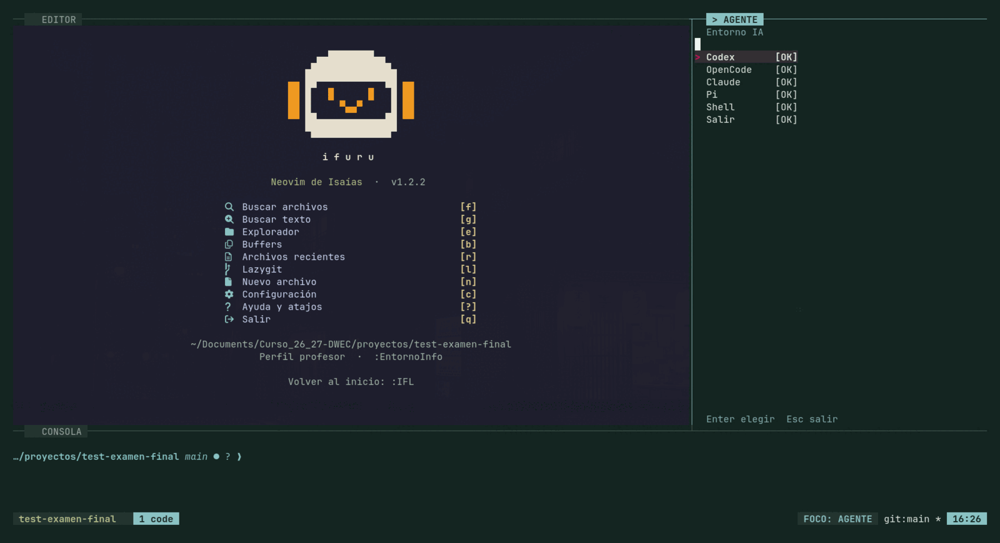

# Pi + Jarvis: tu asistente en la terminal

> **Guía de piloto · pendiente de prueba con una cuenta de alumno y en los
> equipos del aula.** La configuración de modelos se ha comprobado con Pi
> 1.5.2 y una clave ficticia; la instalación y la conversación con el servidor
> aún no se han validado de extremo a extremo.

Pi es una aplicación de terminal con la que puedes conversar con Jarvis. El
profesor te indicará cuándo utilizarla y te facilitará tu cuenta y clave personal.

| Modelo | Para qué sirve |
| --- | --- |
| **jarvis-tutor** | Preguntar, comprender conceptos y recibir pistas. Es el punto de partida. |
| **jarvis-coder** | Ayuda con programación cuando el profesor lo indique. |

La reserva de clase puede determinar el modo aplicado por el servidor. Elegir
un modelo en Pi no evita las reglas o restricciones de la clase. Tutor intenta
guiar el aprendizaje, pero sus respuestas pueden equivocarse: revísalas.



*El entorno dispone de un panel para agentes. La conexión y las opciones de Pi
que se describen abajo aún deben probarse en ese panel.*

## 1. Antes de empezar

Necesitas el entorno instalado, conexión a Jarvis, tu cuenta de alumno y tu
**clave API personal**. El profesor te entregará los datos de acceso o te
indicará cómo obtener la clave en **Mi Key** de
[Jarvis](https://jarvis.ieshlanz.es). La clave API no es tu contraseña de acceso.
El profesor debe activar una reserva para tu grupo y horario si así lo exige el
servicio.

Trabaja en una terminal Linux; en Windows utiliza la terminal de Ubuntu en WSL,
no PowerShell. Para esta guía se usa Bash.

## 2. Instalar Pi

Comprueba primero las herramientas:

```bash
node --version
npm --version
pi --version
```

Si `pi` no existe, hay que instalarlo. Pi requiere Node.js **22.19 o superior**.
Si faltan Node o npm, consulta al profesor antes de continuar: el Node que el
entorno instala para sus propias herramientas puede no estar disponible en tu
terminal. No uses `sudo` para instalar Pi.

La [web oficial de Pi](https://pi.dev/) ofrece varias formas de instalación.
Esta es su alternativa con npm, fijada aquí a la versión 1.5.2 para el piloto y
con los scripts de instalación deshabilitados:

```bash
npm install -g --ignore-scripts @earendil-works/pi-coding-agent@1.5.2
pi --version
```

Esta instalación es **global para tu instalación de Node**: no es parte del
instalador del entorno. Si falla por permisos o `pi` sigue sin encontrarse, no
repitas el comando con `sudo`: consulta al profesor. La instalación con npm y
la versión de Node de cada equipo todavía deben probarse en el aula.

## 3. Configurar Jarvis una sola vez

Pi guarda los modelos personalizados en `~/.pi/agent/models.json`. Antes de
crear el archivo, comprueba si ya existe:

```bash
ls -l ~/.pi/agent/models.json
```

Si dice que no existe, crea la carpeta y abre el archivo en un editor:

```bash
mkdir -p ~/.pi/agent
nano ~/.pi/agent/models.json
```

Copia este contenido completo. **No sustituyas `${JARVIS_API_KEY}` por tu
clave**: es el nombre de una variable que rellenarás en el siguiente paso.

```json
{
  "providers": {
    "jarvis": {
      "baseUrl": "https://jarvis.ieshlanz.es/v1",
      "api": "openai-completions",
      "apiKey": "${JARVIS_API_KEY}",
      "models": [
        {
          "id": "jarvis-tutor",
          "name": "Jarvis Tutor",
          "contextWindow": 40960,
          "maxTokens": 2048
        },
        {
          "id": "jarvis-coder",
          "name": "Jarvis Coder",
          "contextWindow": 40960,
          "maxTokens": 16384
        }
      ]
    }
  }
}
```

En Nano, guarda con `Ctrl+O`, pulsa `Enter` y sal con `Ctrl+X`. Si el archivo
**ya existía**, no lo reemplaces: pide ayuda al profesor para guardar una copia
y añadir Jarvis sin perder tus otros proveedores. La
[documentación oficial de modelos](https://github.com/earendil-works/pi/blob/main/packages/coding-agent/docs/models.md)
explica el formato. Los límites indicados corresponden a la configuración
registrada el 20/11/2026; podrían cambiar en el servidor.

## 4. Introducir la clave y hablar con Tutor

En una terminal privada y sin proyectar la pantalla, ejecuta primero:

```bash
read -rs -p 'Clave API de Jarvis: ' JARVIS_API_KEY; printf '\n'
```

Cuando aparezca `Clave API de Jarvis:`, pega tu clave y pulsa `Enter`: **no se
mostrará mientras escribes**. A continuación ejecuta:

```bash
export JARVIS_API_KEY
pi --provider jarvis --model jarvis-tutor --no-tools --no-extensions --no-session
```

Pi se abrirá. Escribe, por ejemplo:

> Explícame con un ejemplo qué hace un bucle `for` y después hazme una pregunta
> para comprobar si lo he entendido.

Pulsa `Enter` y espera la respuesta. Puedes seguir preguntando en la misma
conversación. Al salir de Pi, ejecuta `unset JARVIS_API_KEY` para eliminar la variable de esa
terminal. Al cerrar la terminal también termina esa sesión de entorno.

Las opciones desactivan herramientas y extensiones y evitan guardar la sesión
de Pi para esta prueba. No convierten el ordenador en un entorno aislado.

Para probar **Coder**, con la misma clave ya introducida, cambia solo la línea
que arranca Pi por:

```bash
pi --provider jarvis --model jarvis-coder --no-tools --no-extensions --no-session
```

Al terminar, ejecuta `unset JARVIS_API_KEY`. Para que Coder pueda trabajar con
archivos o comandos haría falta habilitar herramientas; no lo hagas sin
indicaciones del profesor.

## 5. Abrir el panel del entorno

```bash
cd /ruta/de/tu/proyecto
entorno-dev --ia
```

El selector ofrece **Pi**; `[OK]` indica que encuentra el ejecutable, no que la
clave o el servidor funcionen. `Ctrl+a` y luego `a` lleva al panel del agente;
`Ctrl+a` y luego `n` devuelve al editor. **El selector arranca Pi sin garantizar
las opciones de conversación anteriores.** Además, una sesión tmux existente
puede conservar variables antiguas: no está comprobado que reciba tu clave ni
el modelo elegido. Para el piloto usa primero la terminal directa del paso 4;
la integración del panel se validará antes de distribuirla al grupo.

## 6. Preguntar sobre código del editor

> Esta función pertenece al entorno y necesita un agente activo en su panel.
> El recorrido concreto con Pi y Jarvis sigue pendiente de prueba real. En la
> prueba directa con `--no-tools` Pi puede explicar o proponer código, pero no
> modifica archivos por sí mismo.

| Acción | Teclas |
| --- | --- |
| Abrir el selector de agentes | `Ctrl+a`, soltar, y después `i` |
| Ir al panel de IA | `Ctrl+a`, soltar, y después `a` |
| Volver al editor | `Ctrl+a`, soltar, y después `n` |
| Preparar una pregunta | En modo normal, `Espacio`, `a`, `c` |
| Preparar una pregunta sobre código | Seleccionar en modo visual y pulsar `Espacio`, `a`, `c` |

Por ejemplo, para pedir ayuda con unas líneas:

1. Abre el archivo en el editor y sitúa el cursor en la primera línea.
2. Pulsa `V` mayúscula y mueve el cursor para seleccionar las líneas que
   necesitas. Para seleccionar caracteres en vez de líneas, usa `v`.
3. Pulsa `Espacio`, luego `a` y después `c`. Cuando aparezca `Agente:`, escribe,
   por ejemplo, «Dame una pista para encontrar el error sin resolverlo» o
   «Explícame qué cambiarías y por qué». Pulsa `Enter`.
4. El entorno prepara el fragmento y la petición en el panel del agente. Ve al
   panel con `Ctrl+a` y después `a`, **revisa lo que se ha pegado y pulsa
   `Enter` allí** para enviarlo. La selección no se envía automáticamente.
5. Lee la respuesta y vuelve al editor con `Ctrl+a` y después `n`. En este modo
   de chat aplica tú los cambios que consideres correctos y compruébalos.

Con `Espacio a c` en modo normal se envían metadatos y la petición, no el
contenido completo del archivo. En modo visual se añade la selección. El envío
puede fallar si no hay un agente reconocido o si el panel contiene solo una
shell. Evita seleccionar contraseñas, claves o datos que no deban compartirse.

## Si algo falla

- **`pi: command not found`**: comprueba instalación y PATH con el profesor.
- **No aparecen los modelos**: revisa el JSON, que la clave se haya introducido
  en esa terminal y que no falten comillas o comas.
- **Error de autenticación o acceso**: confirma que copiaste tu propia clave,
  que tu cuenta está activa y que existe una reserva para tu grupo y horario.
  No envíes la clave al profesor por chat para diagnosticarlo.
- **Sin respuesta o error de conexión**: consulta al profesor; puede ser red,
  disponibilidad del servidor o configuración. La prueba real está pendiente.

**Cuida tu clave como una contraseña.** No la subas a Git, no la escribas en el
código, no la compartas ni la pegues en capturas. En un equipo compartido usa
tu sesión personal y ciérrala al terminar. Si crees que una clave se ha
expuesto, avisa al profesor para revocarla y emitir otra. Una variable de
entorno reduce exposiciones accidentales, pero no es un almacén seguro.

Fuentes: [Pi, web e instalación](https://pi.dev/),
[modelos y proveedores de Pi](https://github.com/earendil-works/pi/blob/main/packages/coding-agent/docs/models.md)
y [opciones de Pi](https://github.com/earendil-works/pi/blob/main/packages/coding-agent/docs/cli.md).
